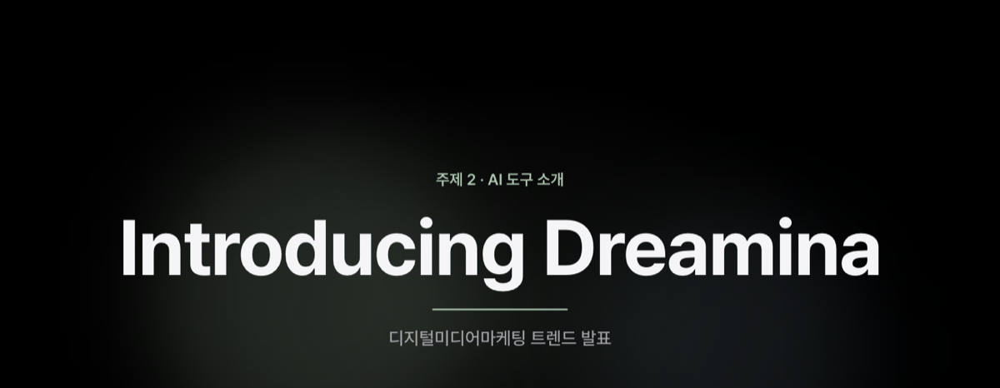
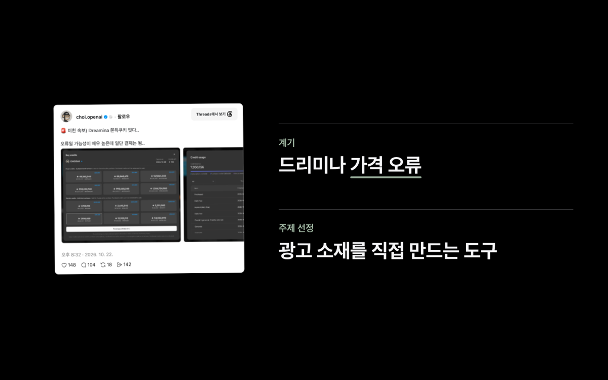

# Introducing Dreamina

AI 영상 도구 드리미나(Dreamina)로 촬영 없이 광고 시안을 만드는 법을 소개한 수업 발표 장표

| 기간 | 수업 | 결과 | 배포 |
|---|---|---|---|
| 2026.10 ~ 11 | 서울시립대 경영학부 디지털미디어마케팅(2026년 2학기, AI 마케팅 마이크로디그리 이수 과목) 트렌드 발표 | 수업 발표 | [장표](https://introducing-dreamina.vercel.app) · [영상](https://www.youtube.com/watch?v=dbqspbI4yoY) |

## 문제의식

- 광고 소재는 자주 바꿔야 성과 유지
- 매번 촬영하기에는 시간과 비용 부담
- 작은 브랜드의 마케터일수록 소재를 여러 개 만들어 비교할 여력 부족

## 해결 방법

- 마케터 혼자 광고 시안을 여러 편 만들 수 있는 도구로 드리미나 선정
- 직접 써 본 과정을 영상으로 제작: 사이트 사용법, AI 에이전트 연결, 그렇게 만든 광고 세 편
- 영상 속 장면, 가상 제품, 진행자, 목소리, 배경음악 모두 드리미나로 생성

## 주요 기능

장표 구성

- 표지
- 계기: 드리미나를 직접 써 보게 된 이야기
- 주제 선정 이유와 영상 소개
- 발표 영상(유튜브) 재생

## 만들며 부딪힌 문제

- 실제 브랜드와 플랫폼 이름이 든 지시의 생성 거절
  - 원인: 도구의 제3자 콘텐츠 제한
  - 해결: 가상 브랜드와 가상 진행자로 전환
- 지시하지 않은 소품 글자가 엉터리로 생성
  - 원인: 지시문에 없는 글자는 모델이 임의 생성
  - 해결: 넣을 글자를 지시문에 직접 명시
- 음성 목록에 한국어 없음
  - 해결: 한국어 문장 입력 시 정상 낭독 확인, 그 음성을 참고로 진행자 입 모양 일치

## 회고

- 주제를 고른 계기: 영상 생성 도구를 혼자 다루기보다 Claude, GPT 같은 최신 모델의 보조를 받아 작업하는 편이 낫다는 판단
- 복사와 붙여넣기의 비효율: 모델에게 받은 지시문을 도구에 옮겨 붙이는 과정이 번거로워 직접 연결할 방법을 찾았고 CLI 연결을 채택
- 전부 맡긴 결과: 제작을 Claude에게 전적으로 맡기자 원하는 방향에서 벗어난 결과물이 다수
- HTML 장표: 평소 HTML로 만들어 PDF로 뽑던 방식에서 나아가 HTML 안에서 바로 발표, 영상 재생까지 한 화면에서 처리
- HTML을 활용한 영상 제작: 기대보다 높은 완성도 확인
- 영상 편집 감각: 직접 영상을 만들어 보며 편집의 흐름을 익힘

## 기술

- 마케팅 실무에 필요한 HTML 제작과 영상 편집을 수업 과제에 직접 적용
- HTML, CSS, JavaScript 한 장짜리 발표 화면, 영상은 유튜브에 올려 장표 안에서 재생
- AI 도구: 영상 소재는 드리미나(Seedream, Seedance, Seed Audio), 대본·자막·편집은 AI 코딩 도구(Claude Code). 수업 규정에 따라 AI 활용 선언문 제출

## 자료 출처 · 실행

- `index.html`을 브라우저로 열기
- 공개본은 표지의 학번 삭제
